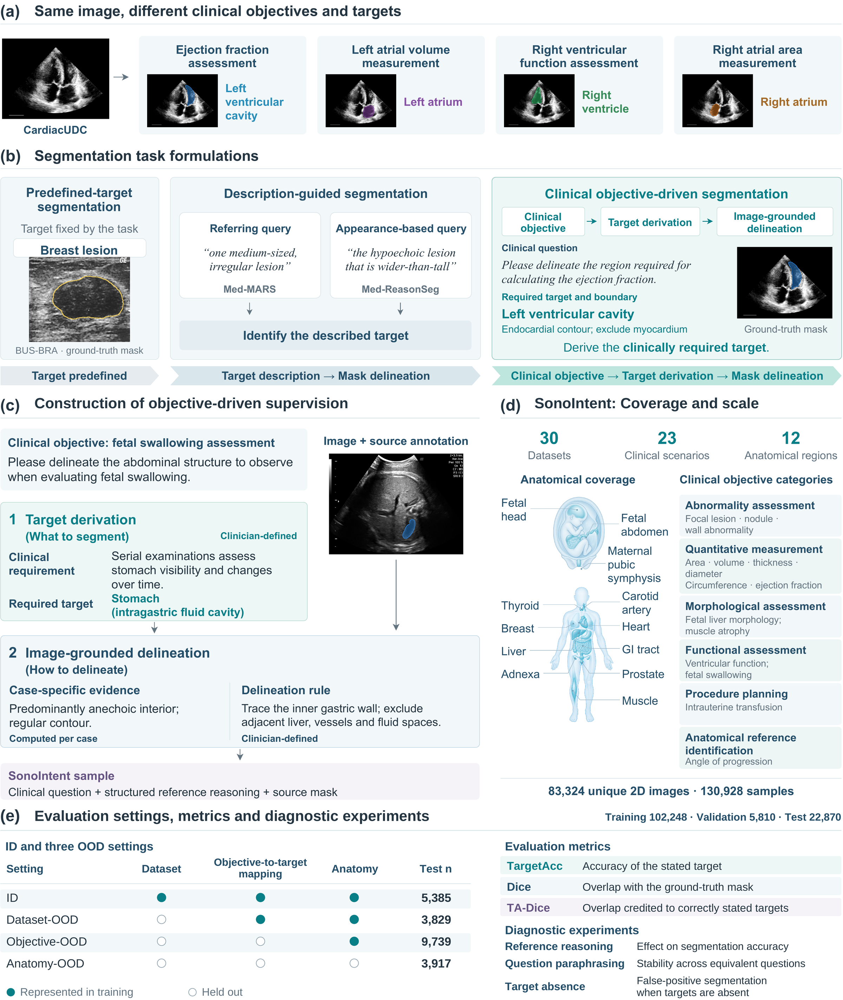

# SonoIntent

SonoIntent is a benchmark for clinical objective-driven ultrasound
segmentation. It contains **130,928 image–question samples** from **83,324
ultrasound images** across **30 datasets**, covering **23 clinical scenarios**
and **12 anatomical regions**. Every sample pairs an ultrasound image with a
clinical question and a structured reference reasoning that resolves the
question to the target to be segmented; the target mask is the prediction
target. Models are evaluated in one in-distribution (ID) setting and three
out-of-distribution (OOD) settings.



**[Figure 1. Overview of the SonoIntent benchmark.](assets/figure1.pdf)**

## Task

Ultrasound requests in clinical practice often state a **clinical objective**
— measure ejection fraction, assess a nodule, plan a procedure — rather than
naming the structure to segment. A model must then resolve the objective to
the correct anatomical target before segmenting it. Most existing benchmarks
assume the target is named explicitly; SonoIntent makes objective-to-target
resolution part of the task. Each sample consists of

1. a clinical question, e.g. *"Please delineate the region required for
   calculating the ejection fraction."*;
2. a structured reference reasoning that combines clinician-defined
   objective-to-target mappings and boundary rules with case-specific image
   evidence;
3. a binary segmentation mask of the intended target.

A model that segments the right structure for the wrong objective receives no
credit under the target-aware metrics.

## Composition

| | count |
|---|---:|
| datasets | 30 |
| unique 2D images | 83,324 |
| image–question samples | 130,928 |
| clinical scenarios | 23 |
| anatomical regions | 12 |
| train / val / test | 102,248 / 5,810 / 22,870 |
| target-absent samples (independent test set) | 656 |

The sources span superficial and vascular (11,503 test samples), cardiac
(4,076), musculoskeletal (3,917), abdominal and pelvic (2,336), and obstetric
(1,038) imaging. The questions cover abnormality assessment, quantitative
measurement, morphological assessment, functional assessment, procedure
planning, and anatomical reference identification; Supplementary Table 1 of
the paper lists all 23 scenarios.

## Evaluation settings

The 22,870-sample test set comprises one ID setting and three OOD settings.
Shares refer to the test set.

| setting | samples | share | composition | `ood_type` |
|---|---:|---:|---|---|
| ID | 5,385 | 23.55% | held-in datasets, unseen images | `ID` |
| Dataset-OOD | 3,829 | 16.74% | 5 held-out sources (MUP+MicroSegNet, BUS-UC, DDTI, Fast-U-Net, MMOTU-3D) | `OOD_dataset` |
| Anatomy-OOD | 3,917 | 17.13% | a held-out anatomy (muscle) | `OOD_organ` |
| Objective-OOD | 9,739 | 42.58% | clinical objectives unseen during training | `OOD_intent` |

Target-absent samples form a separate 656-sample test set of breast and liver
questions with empty masks; their `ood_type` is `target_absent`.
Machine-readable subset definitions are in
[`configs/eval_subsets.yaml`](configs/eval_subsets.yaml).

## Metrics

The paper reports **target identification accuracy (TargetAcc)**, **Dice**,
and **target-aware Dice (TA-Dice)**, which credits mask overlap only when the
generated response states the correct target. Across the 26 model
configurations evaluated, the maximum Dice is 89.70% in ID and 18.84% under
Objective-OOD; Sa2VA-14B reaches 99.99% TargetAcc with 10.95% Dice under
Objective-OOD. On the 656 target-absent cases, 25 of the 26 configurations
achieve empty-mask accuracy of at most 3.51%.

This repository implements the mask-level metrics: Dice, IoU, precision and
recall per sample (`sonointent.eval.metrics`), and per-setting aggregation
with gIoU and cIoU (`sonointent.eval.evaluate`). gIoU is the mean of
per-sample pixel IoU, cIoU is total pixel intersection over total pixel union,
and Dice is the mean of per-sample Dice. TargetAcc and TA-Dice require the
generated response text and are not computed here.

## Data access

SonoIntent is built from 30 existing ultrasound datasets. This repository
contains no images, masks or annotations.

The SonoIntent annotation package contains the `public_id`-keyed questions
and reference reasoning, split and setting labels, image and mask SHA-256
values, and a per-source license register. It is being prepared for public
release and is not yet available. It contains no pixel data. Loaders for the
package are provided in `sonointent.data.annotations` and
`sonointent.data.manifest`.

The source datasets remain under their own licenses and are available
through their official channels:

| source | official entry point |
|---|---|
| EchoNet-Dynamic | <https://echonet.github.io/dynamic/> (application required; redistribution prohibited) |
| HC18 (fetal head) | <https://hc18.grand-challenge.org/> · <https://zenodo.org/records/1327317> |
| PSFHS (intrapartum) | <https://doi.org/10.1038/s41597-024-03266-4> |
| CUBS (carotid) | <https://doi.org/10.1016/j.ultrasmedbio.2021.03.022> |
| STMUS (muscle) | <https://doi.org/10.1016/j.compbiomed.2021.104623> |
| BUSI (breast) | <https://doi.org/10.1016/j.dib.2019.104863> |
| DDTI (thyroid) | <https://doi.org/10.1117/12.2073532> |

Several sources are non-commercial, share-alike or registration-only, and
some have no verifiable data-level license; check the source terms before use
or redistribution. Access control on a hosting platform does not by itself
permit redistribution. Release tiers are described in
[`docs/DATA_GOVERNANCE.md`](docs/DATA_GOVERNANCE.md) and component licenses in
[`docs/LICENSE_MATRIX.md`](docs/LICENSE_MATRIX.md).

## Installation

```bash
pip install -e ".[test]"   # library, CLI and pytest
pytest tests/
```

Python 3.10 or later is required, with NumPy and Pillow. The suite contains
27 tests; two count checks skip unless `SONOINTENT_ANNOTATIONS` points to an
annotation package, so 25 pass by default.

## Evaluation

The evaluator accepts masks as 8-bit PNGs (0/255), 0/1 images, or boolean
arrays.

### Paired predictions

Pairs mode is self-contained and does not require the annotation package.
Each JSONL line names a prediction, its reference mask, and the split:

```jsonl
{"public_id": "si_…", "split": "test", "ood_type": "ID", "pred_mask": "preds/si_….png", "gt_mask": "gts/si_….png"}
```

```bash
sonointent-eval --pairs pairs.jsonl --out metrics.json
```

### Benchmark package

Package mode reads setting labels from the annotation package and expects
reference masks at `gts/<public_id>.png`:

```bash
sonointent-eval --annotations SonoIntent-Annotations \
  --predictions preds.jsonl --gt-root gts/
```

`preds.jsonl` contains one object per line:
`{"public_id": "si_…", "pred_mask": "preds/si_….png"}`.

The full expected `public_id` set of the requested split defines the
benchmark. Missing, duplicate, unknown or unreadable predictions make the run
incomplete: the evaluator exits with code 2 and writes no metrics, so a
partial submission cannot produce full-benchmark numbers. Restrict the
benchmark to one subset with `--split target_absent` or
`--split test --ood-type OOD_intent`.

### Python API

```python
import numpy as np
from sonointent.eval.metrics import score

pred = np.array([[0.0, 1.0], [1.0, 0.0]], dtype=np.float32)   # model output
gt   = np.array([[0, 255], [255, 0]], dtype=np.uint8)          # reference mask
dice, iou, precision, recall, inter, union = score(pred, gt)   # 1.0, 1.0, …
```

Binarization follows the official post-processing: float arrays in [0, 1] are
thresholded at `> 0`, stored 0/255 masks at `> 127`, and boolean arrays are
used as-is. Empty masks need no special case: an empty prediction against a
non-empty target scores 0, and two empty masks also score 0. Target-absent
samples are therefore assessed by empty-mask accuracy rather than Dice.

## Scope

This repository provides the annotation loaders, mask metrics and evaluation
CLI. The benchmark construction pipeline, training code and model checkpoints
are not included.

## Citation

```bibtex
@misc{sonointent,
  title        = {The SonoIntent benchmark for clinical objective-driven
                  ultrasound segmentation},
  author       = {Qingbo Kang and Yajun Mu and Wen Wen and Yong Chen and Yiyue Li
                  and Jun Gao and Huahui Yi and Ting Wen and Yuxi Cheng and
                  Zekun Jiang and Kun Wang and Yushuang He and Wenwu Ling and
                  Kang Li},
  howpublished = {\url{https://github.com/sonovision-ai/SonoIntent}},
  note         = {Citation details will be updated upon publication.}
}
```

Until the paper appears, please also cite this repository and the source
datasets listed in the annotation package's source register.

## License

The code in this repository is released under the Apache License 2.0; see
[`LICENSE`](LICENSE). SonoIntent-authored questions and reference reasoning
are intended for release under CC BY 4.0 with the annotation package. The 30
source datasets, their masks and derived frames remain under each source's
own terms; this repository does not relicense them. See
[`docs/LICENSE_MATRIX.md`](docs/LICENSE_MATRIX.md) for details; attribution
obligations for the sources are listed in the annotation package's
`NOTICE.md`.

## Contact

Corresponding authors: Yushuang He (heyushuang0928@scu.edu.cn), Wenwu Ling
(lingwenwubing@163.com), Kang Li (likang@wchscu.cn).
