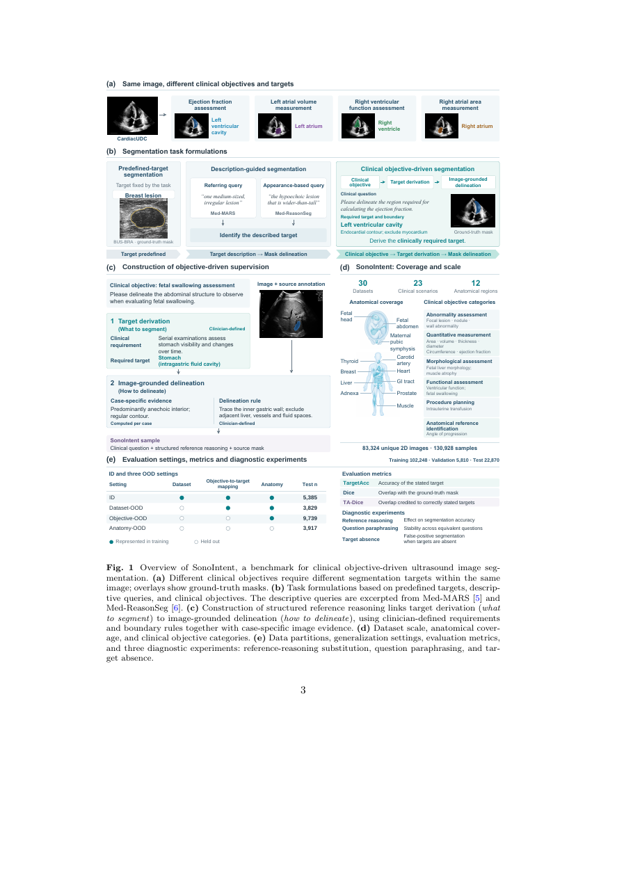

# SonoIntent

**The SonoIntent benchmark for clinical objective-driven ultrasound
segmentation**

SonoIntent is a benchmark of **130,928 image–question samples** derived from
**83,324 ultrasound images** across **30 datasets**, covering **23 clinical
scenarios** and **12 anatomical regions**. Every sample pairs an ultrasound
image with a clinical question and a structured reference reasoning that
explains which target to segment and why; the target mask is the prediction
target. The benchmark evaluates segmentation models under an in-distribution
(ID) setting and three out-of-distribution (OOD) settings.



*Figure 1 from the paper (rendered from the manuscript PDF): the SonoIntent
sample pipeline and the four evaluation settings.*

## Clinical motivation

Ultrasound segmentation requests in clinical practice often specify a
**clinical objective** — measure ejection fraction, assess a nodule, plan a
procedure — rather than naming the target structure. A useful assistant must
first resolve the objective to the correct anatomical target and then segment
it. Existing benchmarks mostly assume the target is named explicitly.
SonoIntent makes objective-to-target resolution part of the task: each sample
consists of

1. a clinical question (e.g., *"Please delineate the region required for
   calculating the ejection fraction."*),
2. a structured reference reasoning that combines clinician-defined
   objective-to-target mappings and boundary rules with case-specific image
   evidence, and
3. a binary segmentation mask of the intended target.

A model that segments the right structure for the wrong objective receives no
credit under the benchmark's target-aware metrics.

## Benchmark composition

| | count |
|---|---:|
| datasets | 30 |
| unique 2D images | 83,324 |
| image–question samples | 130,928 |
| clinical scenarios | 23 |
| anatomical regions | 12 |
| train / val / test | 102,248 / 5,810 / 22,870 |
| target-absent samples (independent test set) | 656 |

The 30 sources span superficial and vascular (11,503 test samples), cardiac
(4,076), musculoskeletal (3,917), abdominal and pelvic (2,336), and obstetric
(1,038) imaging. The clinical questions cover abnormality assessment,
quantitative measurement, morphological assessment, functional assessment,
procedure planning, and anatomical reference identification; the full
scenario inventory is Supplementary Table 1 of the paper.

## Four evaluation settings

The 22,870-sample test set is organized into one ID setting and three OOD
settings (test-set share in parentheses):

| setting | samples | share | composition | `ood_type` field value |
|---|---:|---:|---|---|
| ID | 5,385 | 23.55% | held-in datasets, unseen images | `ID` |
| Dataset-OOD | 3,829 | 16.74% | 5 held-out sources (MUP+MicroSegNet, BUS-UC, DDTI, Fast-U-Net, MMOTU-3D) | `OOD_dataset` |
| Anatomy-OOD | 3,917 | 17.13% | a held-out anatomy (muscle) | `OOD_organ` |
| Objective-OOD | 9,739 | 42.58% | clinical objectives unseen during training | `OOD_intent` |

Target-absent samples form a separate 656-sample test set (breast and liver
questions with empty masks) with `ood_type` `target_absent`.

## Metrics

The paper reports **target identification accuracy (TargetAcc)**, **Dice**,
and **target-aware Dice (TA-Dice)** (mask overlap credited only when the
generated response states the correct target). Reported findings include a
maximum Dice of 89.70% in ID versus 18.84% under Objective-OOD across the 26
evaluated model configurations, and Sa2VA-14B reaching 99.99% TargetAcc with
10.95% Dice under Objective-OOD. On the 656 target-absent cases, 25 of 26
configurations achieved valid empty-mask accuracy of at most 3.51%.

This repository provides the mask-level metrics and an aggregation script:
Dice, IoU, precision, recall (`sonointent.eval.metrics`), and per-setting
aggregation with gIoU/cIoU (`sonointent.eval.evaluate`). Following the
paper's evaluation pipeline, **gIoU is the mean of per-sample pixel IoU**
and **cIoU is total pixel intersection over total pixel union**; Dice is the
mean of per-sample Dice. TargetAcc / TA-Dice depend on the model's generated
text and are reported in the paper's evaluation pipeline (not yet included
here).

## Dataset access

The SonoIntent annotation package (public `public_id`-keyed annotations,
portable index, per-source license register) is **not yet deployed** to a
public repository; this repository ships no annotations, images or masks.

The 30 source datasets remain under their own licenses. Access them through
the official channels; the per-source register (license status, official URL,
DOI, access restrictions) ships with the annotation package. Examples of
official links verified for this README:

| source | official entry point |
|---|---|
| EchoNet-Dynamic | <https://echonet.github.io/dynamic/> (application required; redistribution prohibited) |
| HC18 (fetal head) | <https://hc18.grand-challenge.org/> · <https://zenodo.org/records/1327317> |
| PSFHS (intrapartum) | <https://doi.org/10.1038/s41597-024-03266-4> |
| CUBS (carotid) | <https://doi.org/10.1016/j.ultrasmedbio.2021.03.022> |
| STMUS (muscle) | <https://doi.org/10.1016/j.compbiomed.2021.104623> |
| BUSI (breast) | <https://doi.org/10.1016/j.dib.2019.104863> |
| DDTI (thyroid) | <https://doi.org/10.1117/12.2073532> |

Several sources carry non-commercial / share-alike / registration conditions,
and some have no verifiable data-level license; researchers must check the
source terms before use or redistribution. A Hugging Face gate, if ever used,
is access control — not a redistribution authorization.

## Installation

```bash
pip install -e ".[test]"        # library + test dependencies
pytest tests/                    # 20 unit tests
```

Requires Python ≥ 3.10, `numpy`, and (for the evaluator) `Pillow`.

## Data preparation

Two evaluation input modes are supported; both expect masks as 8-bit PNGs
(0/255), 0/1 images, or boolean arrays:

**Pairs mode** (self-contained; runs without the dataset package):

```jsonl
{"public_id": "si_…", "split": "test", "ood_type": "ID", "pred_mask": "preds/si_….png", "gt_mask": "gts/si_….png"}
```

**Package mode** (uses the annotation package for setting labels; the full
expected public_id set of the requested split is the benchmark — missing,
duplicate or unknown predictions mark the run incomplete):

```bash
sonointent-eval --annotations SonoIntent-Annotations \
  --predictions preds.jsonl --gt-root gts/
```

`preds.jsonl` lines: `{"public_id": "si_…", "pred_mask": "preds/si_….png"}`
(the values are JSON strings, one object per line). Reference masks live at
`gts/<public_id>.png`. Restrict the benchmark to one subset with
`--split target_absent` or `--split test --ood-type OOD_intent`.

The evaluator follows the paper's failure accounting: a missing or unreadable
prediction marks the run incomplete (exit code 2) and writes no metrics — a
partial submission never produces full-benchmark numbers and a failed sample
is never silently scored as zero.

## Evaluation and metrics (library)

```python
import numpy as np
from sonointent.eval.metrics import score
from sonointent.eval.settings import SETTINGS      # ("ID", "OOD_dataset", "OOD_organ", "OOD_intent")

pred = np.array([[0.0, 1.0], [1.0, 0.0]], dtype=np.float32)   # model output
gt   = np.array([[0, 255], [255, 0]], dtype=np.uint8)          # SonoIntent mask
dice, iou, precision, recall, inter, union = score(pred, gt)   # 1.0, 1.0, …
```

Binarization follows the official post-processing: float arrays in [0, 1] are
thresholded at `> 0`, stored 0/255 masks at `> 127`, boolean arrays as-is.
Empty handling matches the official definition without special cases: an
empty prediction against a non-empty target scores 0.

## Reproducibility scope

**Included and runnable here:** mask metrics with the official definitions,
per-setting aggregation, loading and count verification for the public
annotation package (`sonointent.data.annotations`,
`sonointent.data.manifest`), and unit tests covering all of the above.

**Not included (internal or not yet published):** the render/build pipeline
that produced the 83,324 frames and masks from the 30 sources (frame
extraction rules, CAMUS intermediate-frame propagation, ACOUSLIC
interpolation), the reasoning-template engine, the training recipes for the
26 model configurations, and the end-to-end model evaluation harness with
TargetAcc / TA-Dice. This repository therefore verifies and scores against a
**frozen benchmark**; it does not rebuild the benchmark from raw sources.

## Citation

```bibtex
@misc{sonointent,
  title  = {The SonoIntent benchmark for clinical objective-driven
            ultrasound segmentation},
  author = {Qingbo Kang and Yajun Mu and Wen Wen and Yong Chen and Yiyue Li
            and Jun Gao and Huahui Yi and Ting Wen and Yuxi Cheng and
            Zekun Jiang and Kun Wang and Yushuang He and Wenwu Ling and
            Kang Li},
  year   = {TODO: publication year},
  note   = {Citation details will be updated upon publication.}
}
```

Until publication, please also cite this repository and the 30 source
datasets listed in the dataset package's source register.

## License and third-party acknowledgments

- **Code license:** pending project-lead approval. Apache-2.0
  (<https://www.apache.org/licenses/LICENSE-2.0>) is the current proposal;
  no `LICENSE` file is shipped until the license is approved.
- **SonoIntent-authored texts** (questions, reference reasoning): a CC BY 4.0
  release is proposed (<https://creativecommons.org/licenses/by/4.0/>),
  pending legal confirmation.
- **Third-party data:** the 30 source datasets, their masks and derived
  frames remain under each source's own terms. SonoIntent does not relicense
  them. Attribution obligations known today are listed in the dataset
  package's `NOTICE.md` and per-source register; users must check each source
  before redistribution.

## Contact

Corresponding authors (from the paper): Yushuang He
(heyushuang0928@scu.edu.cn), Wenwu Ling (lingwenwubing@163.com), Kang Li
(likang@wchscu.cn).
